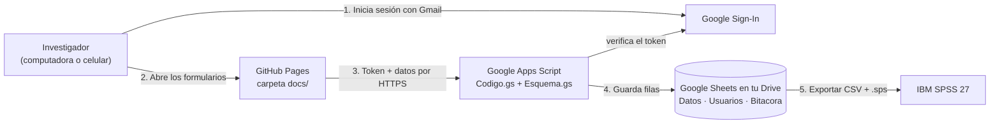

# Cédula electrónica de recolección de datos — Protocolo PI-2026-7694

Aplicación web **gratuita y de código abierto** para capturar la *Hoja de recolección de datos* (Anexo 3) del protocolo:

> **«Asociación del índice neutrófilo/linfocito con la dependencia funcional a los 90 días en pacientes con evento cerebrovascular isquémico agudo»** — HGZ/MF No. 12, Lázaro Cárdenas, Michoacán.

- Inicio de sesión con **Gmail** y **aprobación por el administrador** antes de poder capturar.
- Formularios con las 8 secciones del Anexo 3, criterios de selección, NIHSS (Anexo 5) y entrevista telefónica de la mRS (Anexo 6).
- Cálculo automático de **NLR**, **NLR ≥ 3,51**, **categoría NIHSS**, **tiempo síntomas-puerta**, **ventana de 90 ± 14 días**, **mRS dicotómica** y **dictamen**.
- Los datos se guardan en una **hoja de Google Sheets privada en tu Google Drive** (una fila por paciente, valores codificados).
- Exportación a **IBM SPSS 27** (CSV + sintaxis `.sps` con etiquetas de variables y de valores).

**Aplicación:** https://davmz86.github.io/protocolo-ictus-inl/  
**Demostración (datos sólo en tu navegador):** https://davmz86.github.io/protocolo-ictus-inl/?demo

---

## 1. ¿Cómo funciona?



| Pieza | Para qué sirve | Costo |
|---|---|---|
| **GitHub Pages** (este repositorio, carpeta `docs/`) | Publica la página con los formularios | Gratis |
| **Google Identity Services** | Botón «Iniciar sesión con Google» | Gratis |
| **Google Apps Script** (`apps-script/`) | API que verifica la cuenta, controla la aprobación y escribe en la hoja | Gratis |
| **Google Sheets** en tu Drive | La tabla de datos (hoja `Datos`), usuarios y bitácora | Gratis |
| HTML + CSS + JavaScript sin dependencias | Interfaz | Código abierto (MIT) |

Los datos **nunca** pasan por GitHub: el repositorio sólo contiene el código.

---

## 2. Puesta en marcha (una sola vez, ≈ 20 minutos)

> Use siempre **la misma cuenta de Gmail** (la del administrador) en los pasos 1 a 3.

### Paso 1 · Crear la hoja de cálculo y el backend

1. Abre [Google Drive](https://drive.google.com) → **Nuevo → Hojas de cálculo de Google**. Nómbrala, por ejemplo, `Base Protocolo EVC-NLR`.
2. En la hoja: **Extensiones → Apps Script**. Se abre el editor. Renombra el proyecto (arriba a la izquierda) como `API Cédula EVC`.
3. En el archivo `Código.gs` borra todo y pega el contenido de [`apps-script/Codigo.gs`](apps-script/Codigo.gs) (en GitHub usa el botón *Copy raw file*).
4. Botón **＋ → Secuencia de comandos**, nómbrala `Esquema` y pega el contenido de [`apps-script/Esquema.gs`](apps-script/Esquema.gs).
5. Guarda (💾 o `Ctrl + S`).
6. **⚙ Configuración del proyecto → Zona horaria:** `(GMT-06:00) Hora central - Ciudad de México`.
7. Regresa a la hoja y **recárgala (F5)**. Aparece el menú **Protocolo EVC** → **1) Inicializar / reparar hojas**.
8. Google pedirá autorización. Verás «*Google no verificó esta app*» (es normal: la app es tuya) → **Configuración avanzada → Ir a API Cédula EVC → Permitir**. Si después de autorizar no ves el mensaje «Listo», vuelve a usar el menú **1) Inicializar**.

Se crean las hojas **Datos** (una columna por variable), **Usuarios** y **Bitacora**, y tu cuenta queda como **administrador**.

<details><summary>¿Qué permisos pide y por qué?</summary>

- *Ver y editar esta hoja de cálculo*: sólo la hoja donde vive el script (anotación `@OnlyCurrentDoc`).
- *Conectarse a un servicio externo*: para verificar con Google que el inicio de sesión es auténtico.
- *Enviar correo como tú*: avisos de nuevas solicitudes de acceso y de aprobación.
</details>

### Paso 2 · Crear el «ID de cliente» de Google (inicio de sesión con Gmail)

1. Entra a [Google Cloud Console](https://console.cloud.google.com/) → selector de proyectos → **Proyecto nuevo** → nombre `cedula-evc` → **Crear** (no requiere tarjeta).
2. Menú ☰ → **APIs y servicios → Pantalla de consentimiento de OAuth** (Google Auth Platform) → **Comenzar**:
   nombre de la app `Cédula EVC`, correo de asistencia (el tuyo) → Público: **Externo** → correo de contacto → acepta → **Crear**.
3. **Público** → **Publicar aplicación** → Confirmar (estado *En producción*). Sólo se usan permisos básicos (nombre y correo), así que **no requiere verificación de Google**. No subas logotipo.
4. **Clientes → Crear cliente** → Tipo **Aplicación web** → nombre `Cédula EVC web` →
   **Orígenes autorizados de JavaScript:** `https://davmz86.github.io`
   *(opcional, para pruebas locales: `http://localhost:8080`)* → **Crear**.
5. Copia el **ID de cliente** (termina en `.apps.googleusercontent.com`).

### Paso 3 · Conectar el ID de cliente y publicar la API

1. En la hoja: **Protocolo EVC → 2) Configurar Client ID de Google** → pega el ID → Aceptar.
2. En Apps Script: **Implementar → Nueva implementación** → ⚙ **Aplicación web**:
   - Descripción: `v1`
   - Ejecutar como: **Yo**
   - Quién tiene acceso: **Cualquier usuario**
   → **Implementar** → copia la **URL de la aplicación web** (termina en `/exec`).
3. Prueba: abre esa URL en el navegador; debe mostrar `{"ok":true, ...}`.

> **¿Por qué «Cualquier usuario»?** La página de GitHub llama a la API sin las cookies de Google. La protección la hace el propio script: cada petición debe traer un inicio de sesión de Google válido para *tu* ID de cliente y la cuenta debe estar **aprobada** en la hoja `Usuarios`. La hoja de cálculo sigue siendo privada.

### Paso 4 · Conectar la página

Edita [`docs/js/config.js`](docs/js/config.js) (en GitHub: ícono ✏ → pega los dos valores → *Commit changes*):

```js
window.CONFIG = {
  CLIENT_ID: '1234567890-xxxxxxxx.apps.googleusercontent.com',
  API_URL: 'https://script.google.com/macros/s/AKfy..../exec'
};
```

En 1–2 minutos GitHub Pages publica el cambio y el modo demostración desaparece.

### Paso 5 · Primer uso y alta de usuarios

1. Abre https://davmz86.github.io/protocolo-ictus-inl/ e inicia sesión con **la cuenta dueña de la hoja**: entras como administrador.
2. Comparte la dirección con el residente/investigador. Al iniciar sesión su cuenta queda **pendiente** y te llega un correo.
3. En **Usuarios → Aprobar**. Si también debe exportar la base o aprobar a otros, usa **Hacer admin**.

---

## 3. Uso diario

1. **Nuevo registro**: el folio se propone solo (`EVC-001`, `EVC-002`…). Responde los criterios; el **dictamen** se calcula automáticamente.
2. Captura las secciones II–VI desde el expediente. Puedes **guardar incompleto** y volver después.
3. La lista de **Registros** muestra el avance de cada caso y el estado del seguimiento: *programado* (con la fecha en que abre la ventana), **en ventana** (hay que contactar), *ventana vencida* o *completo*.
4. A los 90 ± 14 días abre el registro y captura la sección VII. El botón **Asistente de entrevista telefónica (Anexo 6)** guía las preguntas y asigna la mRS.
5. La aplicación advierte inconsistencias (p. ej., mRS = 6 sin defunción, HDL + LDL > colesterol total, BH fuera de las primeras 24 h) sin impedir guardar; los valores fuera de rango sí impiden guardar.
6. Si se pierde la conexión o se cierra la pestaña, el formulario se conserva como **borrador** en ese equipo y se ofrece recuperarlo.

Para capacitar a alguien sin tocar la base real: https://davmz86.github.io/protocolo-ictus-inl/?demo (el aviso amarillo incluye el enlace para salir e iniciar sesión con Google).

### En el celular (iPhone y Android)

- Abre la dirección en **Safari** (iPhone) o **Chrome** (Android). Si el enlace llegó por WhatsApp, Facebook, Instagram, etc., usa «Abrir en el navegador»: Google bloquea el inicio de sesión dentro de los navegadores integrados de algunas apps, y la página lo advierte con un botón «Copiar enlace».
- Para tenerla como app: iPhone → **Compartir → Agregar a pantalla de inicio**; Android → **⋮ → Agregar a la pantalla principal**. Se abre siempre en el navegador, que es donde el inicio de sesión de Google funciona de forma fiable.
- Tras cada actualización los celulares cargan la versión nueva automáticamente (los archivos llevan `?v=` con la versión).

## 4. Exportar a SPSS 27

1. En la aplicación (rol admin): **Exportar → Descargar base (.csv)** y **Descargar sintaxis SPSS (.sps)** (el mismo día).
2. Guarda ambos en una carpeta, p. ej. `C:\SPSS\Protocolo_EVC`.
3. En SPSS: **Archivo → Abrir → Sintaxis…** → cambia la ruta de la línea `CD` → **Ejecutar → Todo**.
4. Se crea `base_evc.sav` con nombres, etiquetas de variables, etiquetas de valores (0 = Masculino…), nivel de medición y formatos de fecha/hora.

Variables clave para el análisis del protocolo: `mrs_dic` (desenlace), `nlr_cat` (exposición), `nihss` (ajuste), `mrs_90`, `nlr`.
El diccionario completo está en [`diccionario/DICCIONARIO_VARIABLES.md`](diccionario/DICCIONARIO_VARIABLES.md) y en la pestaña **Ayuda** de la aplicación.

## 5. Seguridad y confidencialidad

- **No se capturan identificadores** (nombre, NSS, domicilio, teléfono); cada paciente es un folio. La lista que relaciona folio ↔ expediente debe guardarse **fuera de la aplicación**, en un archivo protegido con contraseña (investigador principal y asesor), como establece el protocolo.
- La hoja de cálculo está en el Drive del administrador y **no se comparte**. Si el investigador principal necesita verla directamente, compártela sólo con su cuenta.
- Cada inicio de sesión se verifica con Google (firma, audiencia, correo verificado). Las sesiones duran 12 h y se cierran con **Salir**; revocar a un usuario surte efecto de inmediato.
- Toda alta, edición, cambio de usuario y exportación queda en la hoja **Bitacora**. Las ediciones simultáneas del mismo registro se detectan y no se sobrescriben.
- El repositorio es público (requisito de GitHub Pages gratuito) pero **no contiene datos**; `.gitignore` bloquea archivos `.csv`, `.sav` y `.xlsx` para evitar subirlos por error.
- Respaldo: Google Sheets guarda historial de versiones (**Archivo → Historial de versiones**). Conviene además descargar un `.xlsx` periódicamente a un medio protegido.

## 6. Mantenimiento

| Tarea | Cómo |
|---|---|
| Actualizar el backend | Pega los nuevos `.gs` → **Implementar → Gestionar implementaciones → ✏ → Versión: Nueva versión → Implementar** (la URL no cambia). |
| Cambiar o agregar variables | Edita `docs/js/esquema.js` → `node tools/sincronizar.mjs` → *commit* → pega el nuevo `Esquema.gs` y crea una nueva versión. Las columnas nuevas se agregan solas al final de la hoja `Datos` sin perder datos. |
| Probar el backend sin Google | `node tools/prueba_backend.mjs` (también corre automáticamente en GitHub Actions). |
| Probar la página localmente | `python -m http.server 8080 --directory docs` → http://localhost:8080/?demo |

## 7. Solución de problemas

| Síntoma | Solución |
|---|---|
| No aparece el botón de Google o dice *origin not allowed* | Agrega `https://davmz86.github.io` en **Orígenes autorizados de JavaScript** del cliente OAuth (paso 2.4). |
| *Acceso bloqueado / sólo usuarios de prueba* | Publica la app: Google Auth Platform → **Público → Publicar aplicación** (paso 2.3). |
| «No se pudo conectar con el servidor» | Revisa `API_URL` en `config.js` (debe terminar en `/exec`) y que la implementación tenga acceso **Cualquier usuario**. |
| «Falta configurar el Client ID» | Menú **Protocolo EVC → 2) Configurar Client ID** (paso 3.1). |
| «La hoja no se ha inicializado» | Menú **Protocolo EVC → 1) Inicializar**. |
| Cambié el código y no se refleja | Crea una **nueva versión** de la implementación (sección 6). |
| No llegan correos de aviso | Revisa *Spam*. El límite gratuito es de 100 correos al día. |
| Fechas corridas un día | Revisa la zona horaria del proyecto de Apps Script (paso 1.6) y vuelve a usar **Inicializar**. |

## 8. Estructura del repositorio

```
docs/                     ← sitio publicado en GitHub Pages
  index.html
  css/estilos.css
  js/config.js            ← CLIENT_ID y API_URL
  js/esquema.js           ← FUENTE ÚNICA: variables, códigos, cálculos y validaciones
  js/spss.js              ← exportación CSV + sintaxis SPSS
  js/app.js               ← interfaz
apps-script/
  Codigo.gs               ← API: sesiones, usuarios, guardado en Sheets
  Esquema.gs              ← copia exacta de docs/js/esquema.js (la genera tools/sincronizar.mjs)
  appsscript.json         ← manifiesto (opcional, para usar clasp)
diccionario/              ← diccionario de variables y sintaxis SPSS de ejemplo (generados)
tools/
  sincronizar.mjs         ← copia el esquema a Apps Script y regenera el diccionario
  prueba_backend.mjs      ← 19 pruebas del backend con Google simulado
```

## Licencia

[MIT](LICENSE). Puede reutilizarse y adaptarse libremente para otros protocolos.
